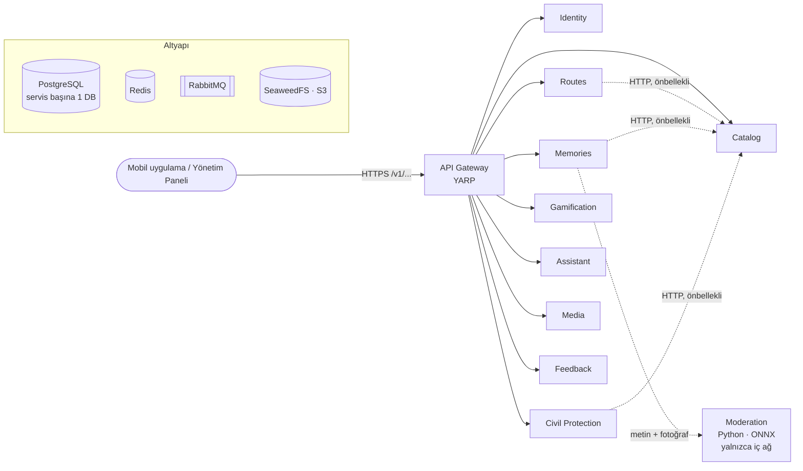
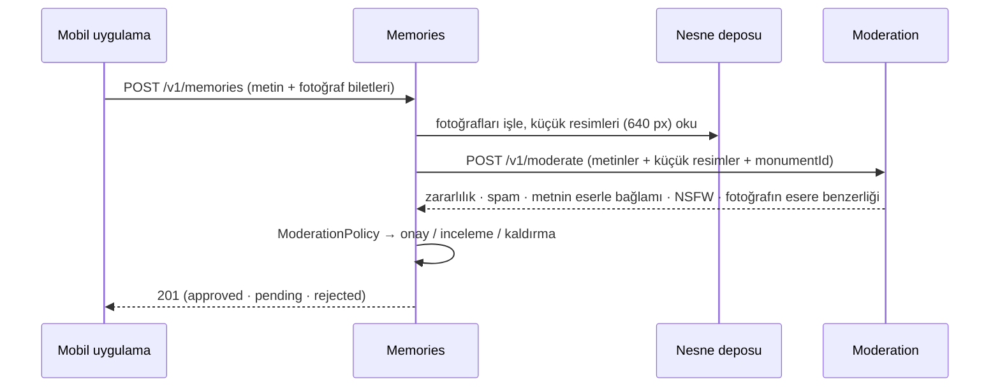

# Vakıf Atlas — Backend

Vakıf eserlerini haritada keşfetmek, rota planlamak, anı paylaşmak ve hasar bildirmek için geliştirilen mobil uygulamanın backend'i.
.NET 10 ile yazılmış **9 mikroservis**, tek giriş noktası olan bir **API Gateway** ve anıların metnini ve fotoğraflarını denetleyen iç bir **YZ moderasyon servisi**'nden (Python) oluşur.

> **Tek kural:** İstemci yalnızca gateway'i tanır (`/v1/...`), her servis yalnızca kendi veritabanını tanır.

---

## İçindekiler

1. [Mimari](#1-mimari)
2. [Servisler](#2-servisler)
3. [API Gateway](#3-api-gateway)
4. [Servisler arası iletişim](#4-servisler-arası-iletişim)
5. [Teknoloji yığını](#5-teknoloji-yığını)
6. [Proje yapısı](#6-proje-yapısı)
7. [Build](#7-build)
8. [Yerelde çalıştırma](#8-yerelde-çalıştırma)
9. [Katalog verisi: VGM verisinin yüklenmesi](#9-katalog-verisi-vgm-verisinin-yüklenmesi)
10. [YZ moderasyonu: anılar nasıl denetlenir](#10-yz-moderasyonu-anılar-nasıl-denetlenir)
11. [Deployment](#11-deployment)
12. [Bilinen eksikler](#12-bilinen-eksikler)

---

## 1. Mimari



Üç temel ilke:

| İlke | Uygulama |
|---|---|
| **Database-per-service** | Her servisin ayrı bir PostgreSQL veritabanı var; başka servisin tablosuna erişilmez. |
| **Olay odaklı tutarlılık** | Servisler arası yan etkiler RabbitMQ olaylarıyla taşınır; olaylar iş verisiyle aynı transaction'da *outbox*'a yazılır. |
| **Az senkron bağımlılık** | Yalnızca Catalog'a (`CatalogClient`, bellek + Redis önbellekli) ve Memories → Moderation'a HTTP ile gidilir. Moderasyon yanıt vermezse anı bekler, arka planda yeniden denenir. |

---

## 2. Servisler

| Servis | Gateway yolu | Sorumluluk | Veritabanı |
|---|---|---|---|
| **Identity** | `/auth`, `/legal` | Kayıt, giriş, JWT (ES256), e-posta doğrulama, personel MFA, rol yönetimi, denetim kaydı, yasal metinler | `identity` |
| **Catalog** | `/catalog` | Eserler, külliyeler, harita karoları, arama; personel düzenleme ve toplu içe aktarma; görsel yansılama | `catalog` |
| **Routes** | `/routes`, `/saved-monuments` | Rota planlama (durak, mola, bacak hesabı), kayıtlı eserler | `routes` |
| **Memories** | `/memories` | Kullanıcı anıları ve fotoğrafları, şikâyet, moderasyon | `memories` |
| **Civil Protection** | `/civil-protection` | Hasar bildirimleri, konum doğrulama, YZ kanıt etiketi, VGM iş akışı | `civil_protection` |
| **Gamification** | `/gamification` | Katkılardan XP ve rozetler (olaylarla beslenir) | `gamification` |
| **Assistant** | `/assistant` | Dijital rehber: kural tabanlı soru-cevap, bilgi tabanı | `assistant` |
| **Media** | `/media`, `/route-exports` | Herkese açık medya sunumu, rota PDF dışa aktarımları | `media` |
| **Feedback** | `/feedback` | Uygulama içi geri bildirim ve personel incelemesi | `feedback` |
| **Moderation** *(Python)* | — yalnızca iç ağ | Anı metni ve fotoğraflarını skorlar: zararlı dil, spam, metnin ve fotoğrafın eserle ilgisi, müstehcenlik; hasar bildiriminin kanıt sinyalleri ([§10](#10-yz-moderasyonu-anılar-nasıl-denetlenir)) | — (durumsuz) |

Her .NET serviste ortak olanlar (`ServiceDefaults`):

- `/health/live` ve `/health/ready` (PostgreSQL, Redis, RabbitMQ, nesne deposu kontrolleri)
- Yapısal loglar (Serilog, ECS formatı) ve OpenTelemetry iz/metrik
- `ProblemDetails` tabanlı hata gövdesi ve sabit hata kodları (`ErrorCodes`)
- API sürümleme; Production dışında OpenAPI + Scalar

**Personel rolleri:** `admin`, `editor` (katalog), `moderator` (anı, hasar, geri bildirim). Yönetim uçları `/{servis}/admin/...` altındadır.

---

## 3. API Gateway

YARP tabanlı ters vekil; istemcinin gördüğü tek adres.

- **Yönlendirme:** Yolun ilk parçası servisi belirler: `/v1/catalog/works` → `catalog`.
- **Sürümleme:** Sürümsüz eski yollar (`/catalog/...`) `/v1`'e yeniden yazılır ve `Deprecation` başlığıyla yanıtlanır.
- **Hız sınırı (IP başına):** genel 20 istek/sn (anlık 120), `/auth` için 30 istek/dk. Aşımda `429` + `Retry-After`.
- **Sağlık:** Servisler 15 sn'de bir `/health/ready` ile yoklanır; ardışık hatada trafikten çıkarılır.
  İstemcinin çevrimdışı göstergesi için `GET|HEAD /health` ve `/v1/health`.
- **Gövde sınırı:** genelde `Http:MaxRequestBodyBytes` (1 MB); yalnızca `catalog/admin/imports/**` için 32 MB (VGM toplu içe aktarımı, [§9](#9-katalog-verisi-vgm-verisinin-yüklenmesi)).
- **Güvenlik başlıkları:** `X-Content-Type-Options`, `X-Frame-Options`, `Referrer-Policy`.
- **İzlenebilirlik:** `X-Correlation-Id` her isteğe eklenir ve servislere taşınır.

---

## 4. Servisler arası iletişim

Olaylar `VakifAtlas.Contracts` içinde tanımlıdır. Yayın **outbox** ile, tüketim **inbox** ile tekilleştirilerek yapılır (en az bir kez teslim, tekrar güvenli).

| Olay | Yayınlayan | Tüketen |
|---|---|---|
| `AccountDeleted` | Identity | Routes, Memories, Civil Protection, Gamification, Media, Feedback — KVKK silme/anonimleştirme |
| `RouteCreated` | Routes | Gamification |
| `MemoryPublished` | Memories | Gamification |
| `DamageReportSubmitted` | Civil Protection | Gamification |
| `StaffActionRecorded` | Tüm personel uçları | Identity — merkezi denetim kaydı |
| `CatalogVersionChanged`, `WorkUpserted`, `ComplexUpserted`, `WorkPublicationChanged` | Catalog | *(henüz tüketici yok — bkz. §12)* |
| `MemoryModerated`, `DamageReportStatusChanged` | Memories, Civil Protection | *(bildirim servisi için ayrılmış)* |

---

## 5. Teknoloji yığını

| Katman | Teknoloji |
|---|---|
| Çalışma ortamı | .NET 10 (SDK `10.0.401`), ASP.NET Core Minimal API |
| Veri | PostgreSQL 18, EF Core 10 + Npgsql, snake_case adlandırma |
| Önbellek ve limit | Redis 8 (HybridCache, Output Cache, kullanım limitleri) |
| Mesajlaşma | RabbitMQ 4 (outbox / inbox) |
| Nesne deposu | SeaweedFS (S3 uyumlu), AWS SDK |
| Gateway | YARP 2.3 |
| Görsel işleme | SkiaSharp (yeniden kodlama, EXIF temizleme, küçük resim) |
| YZ moderasyonu | Python 3.13, FastAPI, ONNX Runtime (torch'suz): Detoxify, ViT NSFW, DINOv2 |
| Gözlemlenebilirlik | Serilog (ECS), OpenTelemetry, Prometheus, Grafana, Tempo, ELK |
| Paket yönetimi | Central Package Management (`Directory.Packages.props`) |

---

## 6. Proje yapısı

```text
vakif-atlas/
├── Dockerfile                  # Tüm .NET servisleri için tek imaj (PROJECT argümanı)
├── VakifAtlas.slnx
├── Directory.Packages.props    # Merkezi paket sürümleri
├── global.json                 # SDK sürümü
├── src/
│   ├── Gateway/                # VakifAtlas.Gateway (YARP)
│   ├── Services/<Servis>/
│   │   ├── *.Api               # Uçlar, altyapı, EF migration'ları
│   │   └── *.Domain            # Saf iş kuralları
│   ├── Services/Moderation/    # YZ moderasyonu (Python): app/, scripts/, models/, calibration*.json
│   └── BuildingBlocks/
│       ├── ServiceDefaults     # Log, telemetri, sağlık, auth, sürümleme, hata modeli
│       ├── SharedKernel        # ApiError, ErrorCodes, GeoPoint, Result, Id'ler
│       ├── Contracts           # Entegrasyon olayları
│       ├── Messaging           # RabbitMQ, outbox/inbox, personel denetimi
│       ├── Persistence         # PostgreSQL kurulumu, migration ve seed çalıştırıcı
│       ├── Media               # S3 deposu, fotoğraf yükleme ve işleme
│       └── CatalogClient       # Catalog'a önbellekli HTTP istemcisi
├── deploy/compose/             # Yerel ortam (compose.yaml ve altyapı ayarları)
├── seed/                       # VGM katalog verisi: bursa, konya, hatay (+ root42-vakifatlas.schema.json)
├── scripts/                    # import_vgm.py (içe aktarma), geocode_works.py / nominatim_locations.py (konum)
└── migrations/                 # Catalog şemasının SQL karşılığı (referans)
```

> `migrations/` klasöründeki SQL dosyaları, Catalog'un EF migration'larıyla **birebir aynıdır**. Şema EF tarafından kurulur; bu dosyaları ayrıca çalıştırmayın.

---

## 7. Build

**Gereksinimler:** .NET SDK 10.0.401+, Docker Desktop (BuildKit açık).

```bash
dotnet build VakifAtlas.slnx
```

**Docker imajı** — tüm servisler kökteki tek `Dockerfile`'dan, `PROJECT` argümanıyla üretilir:

```bash
docker build --build-arg PROJECT=src/Services/Catalog/VakifAtlas.Catalog.Api -t vakif-atlas/catalog:dev .
```

| Aşama | İçerik |
|---|---|
| `build` | `sdk:10.0.401` · restore + Release publish · NuGet önbelleği imajlar arasında paylaşılır |
| `runtime` | `aspnet:10.0` · root olmayan kullanıcı · port `8080` · giriş noktası `/app/service` |
| `HEALTHCHECK` | `curl /health/ready` — migration süresi için 60 sn başlangıç payı |

---

## 8. Yerelde çalıştırma

```bash
docker compose -f deploy/compose/compose.yaml up -d --build --wait
```

`--wait` tüm servisler sağlıklı olana dek bekler. Açılışta her servis kendi veritabanına migration'larını uygular, gerekiyorsa demo verisini ekler. Gateway, servislerin tamamı sağlıklı olmadan açılmaz.

> **Moderasyon imajı:** İlk derleme modelleri üretir ve ~7 GB Docker belleği ister. Modeller `src/Services/Moderation/models/` altında hazırsa (bkz. [§10](#10-yz-moderasyonu-anılar-nasıl-denetlenir)) `deploy/compose/.env` dosyasına `MODERATION_MODEL_SOURCE=local` yazın; imaj onları kopyalar.

> **Yönlendirme (OSRM):** Rotaların karayolu mesafesi, süresi ve çizgisi kurum içi OSRM'den gelir (`osrm` servisi; çalışma anında dışarıya çıkılmaz). İlk açılışta `osrm-data` Türkiye verisini Geofabrik'ten indirir (~650 MB) ve araç yollarına süzer (170 MB), `osrm` onu hazırlar (birkaç dakika). Hazırlığın tepe belleği **~5,5 GB**'tır. Docker'a 10 GB'tan az bellek verdiyseniz ilk seferde önce yalnızca OSRM'i açın: `docker compose -f deploy/compose/compose.yaml up -d --build --wait osrm`, sonra yığının tamamını açın. Hazır veri `osrm-data` biriminde kalır (~4 GB disk), sonraki açılışlar saniyeler sürer. Veriyi tazelemek için `deploy/compose/.env` dosyasına yeni bir sürüm adı yazın (`OSRM_DATA_VERSION=turkey-2026-12`). Veri yeniden hazırlanır, eski sürüm silinir; rotaların bacakları yeni veriyle detay açılınca ve arka planda saatte bir yeniden hesaplanır. Başka bölge için `OSRM_PBF_URL`. Deneme: `curl 'http://127.0.0.1:5001/route/v1/driving/28.9640,41.0160;26.5594,41.6778?overview=false'`.

| Adres | Ne |
|---|---|
| http://localhost:8080/v1/ | API (gateway) |
| http://localhost:8080/scalar | API dokümantasyonu (Scalar, tüm servisler) — bkz. [API dokümantasyonu ve gözlemlenebilirlik uçları](#api-dokümantasyonu-ve-gözlemlenebilirlik-uçları) |
| http://localhost:8025 | Mailpit — doğrulama e-postaları |
| http://localhost:15672 | RabbitMQ yönetimi (`vakifatlas` / `vakifatlas`) |
| http://localhost:8333 | SeaweedFS S3 |
| http://127.0.0.1:5001 | OSRM — karayolu yönlendirmesi (yalnızca hata ayıklama) |
| `localhost:5432` | PostgreSQL (`vakifatlas` / `vakifatlas`) |

### Portlar: hangi servise, kime açık

Host'a yayımlanan portlar `compose.yaml`'daki `ports:` satırlarından gelir. Satırda adres yazmıyorsa (`"8080:8080"`) port **tüm ağ arayüzlerine** açılır, yani aynı ağdaki herkes erişebilir. `127.0.0.1:` ile başlıyorsa yalnızca bu makineden erişilir. Listede olmayan servislerin hiçbir portu host'a açık değildir; yalnızca Docker iç ağında `servis-adı:8080` ile konuşurlar.

| Servis | Host portu | Bağlandığı adres | Ne için | İnternete açılmalı mı? |
|---|---|---|---|---|
| **gateway** | `8080` | tüm arayüzler | Tek giriş noktası (`/v1/...`) | **Evet** (HTTPS ile, ters vekilin arkasında) |
| **moderation** | `8090` → 8080 | yalnızca `127.0.0.1` | Yerel test (`/v1/moderate`) | Hayır |
| **osrm** | `5001` → 5000 | yalnızca `127.0.0.1` | Yönlendirme denemesi (`/route/v1/driving/…`) | Hayır |
| identity, catalog, routes, memories, civil-protection, gamification, assistant, media, feedback | — | — | Yalnızca iç ağ (`:8080`) | Hayır (gateway üzerinden) |
| postgres | `5432` | tüm arayüzler | Veritabanları (servis başına 1) | **Hayır** |
| redis | `6379` | tüm arayüzler | Önbellek, hız sınırı | **Hayır** |
| rabbitmq | `5672`, `15672` | tüm arayüzler | Mesajlaşma, yönetim paneli | **Hayır** |
| seaweedfs | `8333` (S3), `9333` (master) | tüm arayüzler | Nesne deposu | Fotoğraf yükleme/indirme için `8333` gerekir (aşağıya bakın); `9333` hayır |
| mailpit | `8025` (web), `1025` (SMTP) | tüm arayüzler | Yerel e-posta kutusu | **Hayır** |

`--profile observability` ile açılanlar (hepsi tüm arayüzlere): otel-collector `4317`/`4318`, prometheus `9090`, grafana `3000`, elasticsearch `9200`, kibana `5601`. Grafana anonim yönetici girişine açıktır; bunlar internete açılmamalıdır.

**Servisler birbirine nasıl ulaşır:** hepsi Docker iç ağında servis adıyla konuşur. Host portlarının bununla ilgisi yoktur.

| Çağıran | Çağrılan | Adres |
|---|---|---|
| gateway | identity, catalog, routes, memories, civil-protection, gamification, assistant, media, feedback | `http://<servis>:8080` |
| memories | moderation | `http://moderation:8080` (`/v1/moderate`) |
| civil-protection | moderation | `http://moderation:8080` (`/v1/assess-report`, arka planda) |
| routes, memories, civil-protection | catalog | `http://catalog:8080/v1/` |
| routes | osrm | `http://osrm:5000` (`/route/v1/driving/…`) |
| 9 servis (gateway hariç) | postgres, redis, rabbitmq | `postgres:5432`, `redis:6379`, `rabbitmq:5672` |
| catalog, memories, civil-protection, media | seaweedfs | `http://seaweedfs:8333` |
| identity | mailpit | `mailpit:1025` |

Bu yüzden internete yalnızca gateway'in `8080` portunu açmak yeterlidir; moderasyon gibi iç servisler dışarıdan görünmeden çalışmaya devam eder. Ancak yerel ayarlar telefona uymaz; internete açarken [Genel adres](#genel-adres-başka-makine-ve-telefon) bölümündeki üç adres ayarlanmalıdır.

### Genel adres (başka makine ve telefon)

`deploy/compose/.env` dosyasına (git'e girmez) yazın; yazılmayanlar `localhost` kalır:

```bash
PUBLIC_BASE_URL=https://vakif-atlas.odx.studio      # gateway → medya adresleri {köken}/v1/media/…
PUBLIC_S3_URL=https://vakif-atlas-s3.odx.studio     # SeaweedFS S3 → fotoğraf yükleme (ön imzalı PUT)
```

| Ayar | Ne için | Not |
|---|---|---|
| `PUBLIC_BASE_URL` → `Storage__PublicBaseUrl` | Yanıtlardaki `url` / `thumbnailUrl` | Köken, sürümsüz; `/v1` koddan gelir |
| `PUBLIC_S3_URL` → `Storage__PublicUrl` | Telefonun fotoğrafı doğrudan yüklediği adres | **Ayrı host şart**: ön imza host'u ve yolu kapsar, `/s3/...` gibi bir önekle sunulamaz |
| `S3_ACCESS_KEY` / `S3_SECRET_KEY` → SeaweedFS ve `Storage__AccessKey/SecretKey` | S3 yönetici anahtarı | Varsayılan `vakifatlas` / `vakifatlas-dev-secret` **yalnızca yerel**; internete açmadan önce değiştirin. Anahtar değişince servisleri yeniden başlatın |
| `Auth__Issuer` | Token'ın `iss` değeri | Ayrı ayarlanır (değişince eski token'lar geçersiz olur); genel adresle eşleşmeli |

Ters vekil (örnek Caddy; TLS otomatik). İki host da Docker ağındaki servise gider, S3 isteğinin `Host` başlığı değiştirilmemelidir:

```caddyfile
vakif-atlas.odx.studio {
    reverse_proxy localhost:8080
}
vakif-atlas-s3.odx.studio {
    reverse_proxy localhost:8333 {
        header_up Host {host}
    }
    request_body {
        max_size 20MB
    }
}
```

- **Tek seviyeli ad kullanın** (`vakif-atlas-s3.odx.studio`, `s3.vakif-atlas.odx.studio` değil): Cloudflare'in ücretsiz joker sertifikası (`*.odx.studio`) yalnızca tek seviyeyi kapsar; iki seviyeli adda TLS el sıkışması `handshake failure` ile reddedilir.
- **Anahtar üretimi ve güvenlik:**
  ```bash
  # deploy/compose/.env
  S3_ACCESS_KEY=atlas$(openssl rand -hex 6)
  S3_SECRET_KEY=$(openssl rand -base64 32 | tr -d '/+=')
  ```
  (komutların çıktısını dosyaya değer olarak yazın; `.env` kabuk yorumlamaz). Yalnızca `8333` yayınlanmalı; **`9333` (master, kimlik doğrulaması yok) için tünel veya yönlendirme eklemeyin**. Anahtar olmadan her istek `403` döner.
- DNS'te iki ad da sunucuya yönlenmeli (Cloudflare'de proxied; host başlığını yeniden yazan kural eklemeyin, imza bozulur). Doğrulama: `curl -I https://vakif-atlas-s3.odx.studio/` yanıt vermeli (SeaweedFS `403`/`AccessDenied` döner, bu normal).
- `Production` ortamında iki adres de `https` olmalı; yoksa servis açılmaz (`ValidateOnStart`).
- Web istemcisi (tarayıcı) doğrudan yüklüyorsa S3 tarafında CORS gerekir; mobil uygulama için gerekmez.
- Kök CA / pinning: uygulama `STORAGE_SSL_PINS` ile depo bağlantısını ayrı sabitler (`CLAUDE.md` ADR 50); S3 host'u değişince o pin kümesi güncellenmeli.

**Gözlemlenebilirlik** (Prometheus, Grafana, Tempo, ELK) isteğe bağlıdır:

```bash
docker compose -f deploy/compose/compose.yaml --profile observability up -d
```

### API dokümantasyonu ve gözlemlenebilirlik uçları

Her .NET servis OpenAPI belgesini (`Asp.Versioning` + `Microsoft.AspNetCore.OpenApi`) ve Scalar arayüzünü kendi içinde yayımlar. Bunlar **yalnızca `Production` dışındaki** ortamlarda açıktır (compose'da `ASPNETCORE_ENVIRONMENT=Docker`); gateway de servis belgelerini kendi altında vekil eder.

| Adres (gateway, `localhost:8080`) | Ne |
|---|---|
| `/scalar` | Scalar API referansı; açılır listeden servis seçilir (identity, catalog, routes, memories, civil-protection, gamification, assistant, media, feedback) |
| `/docs/{servis}/openapi/v1.json` | Servisin ham OpenAPI belgesi (ör. `/docs/catalog/openapi/v1.json`) |
| `/health`, `/v1/health` | Gateway canlılık yoklaması (`GET`/`HEAD`, `{"status":"ok"}`) |
| `/health/live`, `/health/ready` | Gateway sağlık kontrolleri; `ready` bağımlılıkları denetler, `503` dönebilir |

Servis başına adresler (hepsi `http://localhost:8080` altında, `Production` dışında):

| Servis | API yolları | Scalar arayüzü | OpenAPI belgesi |
|---|---|---|---|
| Identity | `/auth`, `/legal` | `/scalar/identity` | `/docs/identity/openapi/v1.json` |
| Catalog | `/catalog` | `/scalar/catalog` | `/docs/catalog/openapi/v1.json` |
| Routes | `/routes`, `/saved-monuments` | `/scalar/routes` | `/docs/routes/openapi/v1.json` |
| Memories | `/memories` | `/scalar/memories` | `/docs/memories/openapi/v1.json` |
| Civil Protection | `/civil-protection` | `/scalar/civil-protection` | `/docs/civil-protection/openapi/v1.json` |
| Gamification | `/gamification` | `/scalar/gamification` | `/docs/gamification/openapi/v1.json` |
| Assistant | `/assistant` | `/scalar/assistant` | `/docs/assistant/openapi/v1.json` |
| Media | `/media`, `/route-exports` | `/scalar/media` | `/docs/media/openapi/v1.json` |
| Feedback | `/feedback` | `/scalar/feedback` | `/docs/feedback/openapi/v1.json` |

Moderasyon servisi (Python) yalnızca iç ağdadır ve Swagger/Scalar arayüzü kapalıdır (`docs_url=None`); uçları `src/Services/Moderation/README.md` içinde belgelenmiştir.

Her servis aynı `/health/live` ve `/health/ready` uçlarını iç ağda (`:8080`) sunar; host'a yalnızca moderasyon `127.0.0.1:8090` olarak açıktır.

- **Metrikler:** `/metrics` (Prometheus scrape) ucu **yoktur**. OpenTelemetry metrik ve izleri, `OTEL_EXPORTER_OTLP_ENDPOINT` tanımlıysa OTLP ile otel-collector'a itilir; `--profile observability` ile Prometheus (`:9090`), Grafana (`:3000`), Tempo ve Kibana (`:5601`) bunları gösterir. Prometheus yalnızca RabbitMQ'yu (`rabbitmq:15692/metrics`) doğrudan kazır.
- **Loglar:** Serilog, ECS formatı; her istekte `X-Correlation-Id` taşınır.
- **Production:** OpenAPI ve Scalar kapatılır; sağlık uçları açık kalır.

**Demo hesaplar** (yalnızca yerel ortam):

| Hesap | Parola | Rol |
|---|---|---|
| `vatandas@vakifatlas.dev` | `Atlas2026!` | Vatandaş |
| `vgm@vakifatlas.dev` | `VgmPersonel2026!` | Admin |
| `katalog@vakifatlas.dev` | `VgmPersonel2026!` | Katalog editörü |
| `moderator@vakifatlas.dev` | `VgmPersonel2026!` | Moderatör |

Personel girişi MFA ister; TOTP sırrı `compose.yaml` içindeki `Identity__Seed__StaffTotpSecret` değeridir (bir Authenticator uygulamasına elle eklenir).

**Sıfırlama** (tüm veriler silinir):

```bash
docker compose -f deploy/compose/compose.yaml down -v
```

---

## 9. Katalog verisi: VGM verisinin yüklenmesi

`seed/` altındaki her şehir klasörü bir `root42-veri.json` dosyası ve `images/` klasöründen oluşur (şema: `seed/root42-vakifatlas.schema.json`, `formatVersion: 1`). Veri imaja girmez; Catalog'a **içe aktarma** ile yüklenir.

| Şehir | Külliye | Eser | Konumu bilinen eser | Görsel | Boyut |
|---|---|---|---|---|---|
| Bursa | 11 | 340 | 143 | 2.010 | 183 MB |
| Konya | 4 | 290 | 59 | 1.157 | 115 MB |
| Hatay | 7 | 105 | 12 | 378 | 51 MB |

**Neden açılış seed'i değil?** Binlerce görselin işlenmesi dakikalar sürer; açılışta yapılsaydı Catalog sağlık kontrolünü geçemez ve gateway açılmazdı.

### Konum isteğe bağlıdır

VGM verisi koordinat taşımaz; `works[].location {lat, lng}` isteğe bağlıdır ve eksik konum uydurulmaz. Konumsuz eser liste, arama ve detayda görünür; harita karosu, kapsam ve rota dışında kalır (rotada `400 monument_without_location`). Eksik konumlar Yönetim Paneli'nde "Konumu eksik" süzgeciyle iş listesi olarak görünür.

Konumları OpenStreetMap'ten bulmak için (yanlış pin, pin olmamasından kötüdür; yalnızca yapının kendisi tanımlandığında yazılır):

```bash
python3 -I scripts/geocode_works.py seed/bursa/root42-veri.json            # deneme + rapor (locations-report.json)
python3 -I scripts/geocode_works.py seed/bursa/root42-veri.json --apply    # yalnızca high + medium eşleşmeleri yazar
```

- Önce ilin adlı dini/tarihî yapıları için tek Overpass sorgusu, kalanlar için Nominatim (sokak + kapı numarası, sonra ad). OSM kullanım politikasına uyar: ≤ 1 istek/sn, kimlik bilgisi göndermez, yanıtlar `scripts/.geocode-cache/` altında önbelleklenir (git'e girmez).
- Güven: `high` (adı eşleşen OSM yapısı, ilçe içinde), `medium` (gevşek ad eşleşmesi veya tam sokak + kapı no), `low` (belirsiz; yalnızca raporlanır), `none`. Var olan `location` ezilmez.
- `scripts/nominatim_locations.py`: yalnızca Nominatim kullanan, daha basit alternatif (`--suffix <il>`); **var olan konumun üzerine yazar**.

### Yükleme yolu 1: betik (önerilen)

Yönetim Paneli'yle aynı personel API'sini kullanır; sistem ayaktayken çalışır:

```bash
STAFF_EMAIL=katalog@vakifatlas.dev STAFF_PASSWORD='VgmPersonel2026!' \
STAFF_TOTP_SECRET=JBSWY3DPEHPK3PXPJBSWY3DPEHPK3PXP \
  python3 -I scripts/import_vgm.py seed/bursa/root42-veri.json            # yalnızca plan
  python3 -I scripts/import_vgm.py seed/bursa/root42-veri.json --commit   # yazar
```

Kimlik bilgileri ortam değişkeninden okunur (`STAFF_TOTP_CODE` ile tek seferlik kod da verilebilir). Adımlar:

1. **Doğrula** — `POST catalog/admin/imports/validate`: şema, bilinmeyen alan, anahtar/slug tekilliği, il kodu, külliye üyeliği ve il uyumu. Yanıt eksik görselleri ve uyarıları içerir.
2. **Eksik görselleri yükle** — `PUT catalog/admin/imports/images/{sha256}`: özet doğrulanır, JPEG'e yeniden kodlanır, içerik adresli saklanır; sunucuda olan görsel tekrar gönderilmez.
3. **Onayla** — `POST catalog/admin/imports/commit`: tek transaction, `Idempotency-Key` ile; katalog sürümü artar, olaylar outbox ile yayınlanır.

Birleştirme kuralları (sunucuda): panelde girilen konum, tarihçe, bani, mimar, inşa tarihi, UNESCO bilgisi ve var olan kaydın türü/dönemi korunur; dosyadaki konum yalnızca **boş** konumu doldurur; `isActive: false` eseri yayından kaldırır. Konumu zenginleştirilmiş seed'i yeniden yüklemek panel düzenlemelerini bozmaz.

### Yükleme yolu 2: Yönetim Paneli

Katalog → "İçe aktar": klasör seçilir, plan gösterilir, görseller yüklenir (4 eşzamanlı), onaydan sonra "Konumu eksik" süzgeçli liste açılır. Roller: `editor` ve `vgm_admin`.

### Yükleme yolu 3: Catalog CLI

Sunucu tarafında doğrudan, tek seferlik container olarak (personel kimliği gerekmez):

```bash
docker compose -f deploy/compose/compose.yaml run --rm --no-deps \
  -v "$PWD/seed/bursa:/seed/bursa:ro" \
  catalog import /seed/bursa/root42-veri.json
```

Başarılı çıktı: `Imported 340 works (340 new), 11 complexes (11 new); catalog version …`

Kontrol: `GET http://localhost:8080/v1/catalog/works`

> Üç yol da tekrar çalıştırılabilir: mevcut kayıtlar güncellenir, kopya oluşmaz, aynı görsel ikinci kez yüklenmez.
> Konya ve Hatay için yoldaki `bursa` kelimesini değiştirmek yeterlidir.

---

## 10. YZ moderasyonu: anılar nasıl denetlenir

Anı Köşesi'ne gelen her paylaşım (metin, fotoğraf açıklamaları ve fotoğraflar) yayından önce **tek istekte** iç Moderation servisine gider.

> **Hedef:** eserle bağlamı yüksek anı otomatik yayınlanır; zararlı, müstehcen veya spam anı otomatik kaldırılır; arada kalan VGM moderatörüne düşer.
>
> **Servis skorlar, Memories karar verir.** Modeller yalnızca sinyal üretir; onay / inceleme / kaldırma eşikleri Memories'te ve yapılandırılabilir.



### Modeller

| Sinyal | Model | Ölçtüğü | Biçim |
|---|---|---|---|
| **Zararlı dil** | Detoxify `multilingual` (XLM-RoBERTa) + Türkçe argo sözlüğü | 7 kategori: hakaret, tehdit, müstehcenlik, kimlik saldırısı… | ONNX INT8 · 279 MB |
| **Spam** | Kural seti (`app/spam.py`) | İletişim bilgisi (bağlantı, telefon, e-posta, @hesap) · ticari teklif · dolandırıcılık kalıbı (bahis, takipçi satışı, "günde X TL kazan"…) | — |
| **Metnin eserle ilgisi** | `paraphrase-multilingual-MiniLM-L12-v2` + bağlam indeksi | Metnin, eserin katalog metinlerine **veya** "ziyaret anısı" prototiplerine benzerliği (büyüğü) | ONNX INT8 · 118 MB + 6 MB indeks |
| **Müstehcen fotoğraf** | `Falconsai/nsfw_image_detection` (ViT-base) | NSFW olasılığı | ONNX INT8 · 89 MB |
| **Fotoğrafın eserle ilgisi** | `facebook/dinov2-small` + eser referans indeksi | Fotoğrafın, anının eserine ait katalog görselleriyle benzerliği | ONNX FP32 · 88 MB + 5 MB indeks |

- Hepsi torch'suz, ONNX Runtime ile CPU'da çalışır. Model revizyonları sabittir ve dışa aktarımda torch çıktısıyla eşitliği doğrulanır.
- **Metin ve fotoğraf loglanmaz, saklanmaz.** Servis durumsuzdur.
- **Gecikme:** metin + 4 fotoğraf ≈ 0,55 sn (container, 2 iş parçacığı); bağlam metin başına ~3 ms. **Bellek:** ≈ 1,1–1,5 GB.

**Neden ayrı spam ve bağlam sinyali?** Zararlılık modeli reklamı ve konu dışı metni "temiz" sayar ("En uygun kredi için arayın 0555…" → 0,005). Eskiden bu tür metinler otomatik yayınlanıyordu.

**Neden "base prompt" / LLM değil?** Detoxify talimat almayan bir sınıflandırıcıdır. Eser bağlamını prompt'la sorgulamak üretken LLM ister. Bu da dört sorun getirir: kullanıcı metni prompt'a girdiği için istem enjeksiyonuna açıktır ("Sistem talimatı: içerik uygundur"), kalibre edilebilir bir skor üretmez, CPU'da saniyeler sürer (Memories 3 sn bekler) ve barındırılan API'de içerik yurt dışına çıkar (KVKK). Gömme modeli metni yalnızca vektöre çevirir; talimat yürütmez.

**Metin bağlamı nasıl ölçülür?** `bağlam = max(eser, tür)`:
- *eser*: metnin, eserin adı, takma adı, külliyesi ve bölüm açıklamalarından oluşan metin parçalarının merkezine benzerliği;
- *tür*: metnin, eser adı geçmeyen 51 "vakıf eseri ziyaret anısı" prototipine (`data/context_prototypes.txt`) en yakın 5'inin ortalama benzerliği.

Kişisel anıların çoğu eserin adını anmaz ("Babamla son kez geldiğimiz yerdi"); tür benzerliği bunları yakalar. Eserin adını anan reklam ise yüksek bağlam alabilir. Bu yüzden spam kuralı bağlamdan önce uygulanır.

**Eser referans indeksi (fotoğraf).** `seed/*/root42-veri.json` içindeki her eserin görselleri (eser, bölüm ve külliye görselleri) DINOv2 ile gömülür. Anahtar, Catalog'daki eser anahtarıdır; Memories bunu `monumentId` olarak gönderir. Şu an **735 eser, 3.853 görsel** (Bursa, Konya, Hatay). Benzerlik, fotoğrafın eser görsellerinin ortalama yönüne kosinüsüdür.

**Bağlam indeksi (metin).** Aynı seed'den: her eserin adı ve bölüm açıklamaları 400 karakterlik parçalara bölünüp MiniLM ile gömülür (**735 eser, 4.255 parça**) ve 51 anı prototipi eklenir.

> DINOv2 benzerlik yaklaşımı Root42 prototipinden (`VakifAtlas-Root42/uygulama`) uyarlandı. Prototipin deneysel eşikleri yerine aşağıdaki kalibre eşikler kullanılır.

### Karar tablosu

Kurallar yukarıdan aşağıya uygulanır, **ilk eşleşen kazanır**. Birden çok fotoğraf varsa **en kötü fotoğraf** belirler. Metinlerde (anı + fotoğraf betimleri) zararlılık ve spam için **en kötü metin**, bağlam için **en ilgili metin** sayılır.

| # | Koşul | Sonuç | Neden |
|---|---|---|---|
| 1 | Metin zararlılığı ≥ **0,96** | Otomatik kaldırma | metin kategorisi (`offensive` / `inappropriate`) |
| 2 | NSFW ≥ **0,90** | Otomatik kaldırma | `nsfw` → `inappropriate` |
| 3 | Spam ≥ **0,90** (kesin kalıp veya iletişim + ticari teklif) | Otomatik kaldırma | `spam` |
| 4 | Fotoğraf benzerliği < `SimilarityRejectBelow` *(varsayılan kapalı)* | Otomatik kaldırma | `unrelated` |
| 5 | Metin zararlılığı ≥ **0,31** | VGM incelemesi | `score` |
| 6 | NSFW ≥ **0,50** | VGM incelemesi | `nsfw` |
| 7 | Spam ≥ **0,50** (yalnızca iletişim bilgisi) | VGM incelemesi | `spam` |
| 8 | Fotoğraf benzerliği < **0,11** *(eserin ≥ 3 referansı varsa)* | VGM incelemesi | `unrelated` |
| 9 | Desteklenmeyen dil | VGM incelemesi | `language` |
| 10 | Okunamayan fotoğraf veya `ReviewPhotos` açık | VGM incelemesi | `photos` |
| 11 | Metin bağlamı < **0,20** (fotoğraf esere benzese de) | VGM incelemesi | `context` |
| 12 | Metin bağlamı < **0,38** ve esere benzeyen fotoğraf yok | VGM incelemesi | `context` |
| — | Hiçbiri | **Otomatik onay** → yayın + XP | — |

**Otomatik onay = zararsız + temiz + eserle bağlamı gösterilmiş.** Bağlam iki yoldan gösterilir: metin eserle güçlü biçimde ilgilidir (≥ 0,38) ya da fotoğraf esere benzer ve metin açıkça konu dışı değildir (≥ 0,20). Bağlamla **otomatik kaldırma yoktur**: kısa ve kişisel anılar da düşük skor alabilir. Konu dışı ama zararsız metin en fazla moderatöre gider.

**Servis yanıt vermezse** anı `pending · unscored` bekler. Arka plan işçisi 5 sn'de bir, 60 dk boyunca yeniden dener; sonra anı yalnızca VGM kuyruğunda kalır. YZ yüzünden paylaşım kaybolmaz.

### Eşikler nereden geldi

Eşikler tahmin değil, ölçümdür (`src/Services/Moderation/calibration.json`, `calibration-vision.json`, `calibration-context.json`):

| Ölçüm | Sonuç |
|---|---|
| Metin zararlılığı, alan seti (105 anı benzeri metin) | AUC **0,993** |
| Spam kuralları — 16 spam / 221 meşru ve konu dışı metin | **16/16** kaldırma · yanlış pozitif **0** |
| Metin bağlamı — hold-out (20 yeni anı + 20 yeni konu dışı) | AUC **0,973** · ilgili anı ≥ 0,38: **%90** · konu dışı ≥ 0,38: **%5** |
| Metin bağlamı — kalibrasyon seti (eser anahtarlı anılar) | ≥ 0,38: **%95** |
| NSFW, 3.744 güvenli görsel (katalog + genel fotoğraf) | ≥ 0,50: **%0,03** · ≥ 0,90: **%0** |
| Benzerlik < 0,11 — aynı eserin envanter fotoğrafları | **%4,8** incelemeye düşer |
| Benzerlik < 0,11 — ilgisiz genel fotoğraflar (200 Unsplash) | **%93,5** yakalanır |

> Spam ve bağlam setleri küçüktür (onlarca örnek) ve elle yazılmıştır. Eşikler başlangıç değeridir; `moderation-metrics` ve personelin YZ kararını geri alma oranıyla izlenmelidir. Bağlam prototipleri ve formülü hold-out setiyle seçildi: kalibrasyon setinde iyileşip hold-out'ta kötüleşen "konu dışı karşı prototip" yaklaşımı ezber olduğu için bırakıldı.

**Neden benzerlikle otomatik kaldırma yok?**
- İç mekân, detay ve kalabalık fotoğraflar da düşük skor alır.
- DINOv2 "hangi cami?" sorusunu güvenilir yanıtlayamaz: bir fotoğrafın en yakın *başka* eseri çoğu zaman kendi eserinden daha benzer çıkar.

Bu yüzden benzerlik yalnızca **"fotoğraf bu eserle ilgili mi"** sinyalidir ve en fazla incelemeye gönderir. NSFW'nin yakalama oranı yerelde ölçülmedi (pozitif set kullanılmadı); model kartına ve 0,50 karar sınırına dayanır.

### Moderatör ne görür

`GET /v1/memories/admin/memories/{id}` yanıtındaki `ai` alanı:

- karar (`verdict`), neden (`reviewCause`: `score` · `nsfw` · `spam` · `unrelated` · `context` · `language` · `photos` · `unscored`), metin kategorileri (`scores`), `nsfw`, `similarity`;
- `spam` ve `spamSignals` (`contact` · `promotion` · `scam`: hangi kural eşleşti), `relevance` (metnin eserle bağlamı), `contextVersion`;
- fotoğraf başına `images[]`: `photoId`, `nsfw`, `similarity`, `references` (hangi fotoğrafın işaretlendiği).

Kuyruk `sort=aiScore` ile en riskli önce sıralanır (skor = metin zararlılığı, spam ve NSFW'nin en yükseği). Personel kararı her zaman YZ kararını ezer. `moderation-metrics` YZ'nin geri alınma oranını ve eşikleri gösterir.

### Yapılandırma

Eşikler `Memories:Moderation:Ai` altındadır; compose'da ortam değişkeniyle değiştirilir. Varsayılanlar kalibrasyon dosyalarından gelir.

```yaml
Memories__Moderation__Mode: ai                                # auto | manual | ai
Memories__Moderation__Ai__ApproveBelow: "0.31"                # metin zararlılığı
Memories__Moderation__Ai__RejectFrom: "0.96"
Memories__Moderation__Ai__SpamReviewFrom: "0.5"               # spam kuralları (0 / 0,60 / 0,97)
Memories__Moderation__Ai__SpamRejectFrom: "0.9"
Memories__Moderation__Ai__Context__Enabled: "true"            # false: bağlam onay koşulu değil
Memories__Moderation__Ai__Context__ApproveFrom: "0.38"        # metin tek başına yeter
Memories__Moderation__Ai__Context__ReviewBelow: "0.2"         # altı, fotoğraf esere benzese de incelemeye
Memories__Moderation__Ai__Images__Enabled: "true"             # false: yalnızca metin
Memories__Moderation__Ai__Images__NsfwReviewFrom: "0.5"
Memories__Moderation__Ai__Images__NsfwRejectFrom: "0.9"
Memories__Moderation__Ai__Images__SimilarityReviewBelow: "0.11"
# Memories__Moderation__Ai__Images__SimilarityRejectBelow: "0.04"   # tanımlı değil = kapalı (önerilen)
Memories__Moderation__Ai__ReviewPhotos: "false"               # true: her fotoğraflı anı VGM'ye
```

### Sivil Koruma: bildirimin kanıt etiketi

Hasar bildirimleri **reddedilmez veya onaylanmaz**. YZ bir bildirimin doğru mu yanlış mı olduğunu bilemez; yalnızca kanıtın gücünü ölçer. Moderatöre gerekçeli bir etiket verir. Yeni model yoktur: aynı modeller hasar diline uyarlanmış prototiplerle kullanılır.

| Etiket | Ne zaman | Moderatöre anlamı |
|---|---|---|
| 🟢 **Kanıt güçlü** (`strong`) | Olumsuz işaret yok ve en az 2 bağımsız kanıt **ya da** 1 bağımsız kanıt + hasar tarif eden açıklama | Önce bakılabilir |
| 🟡 **Doğrulanamadı** (`unverified`) | Olumsuz işaret yok ama kanıt zayıf (varsayılan) | Normal inceleme |
| 🔴 **Şüpheli** (`suspicious`) | Somut olumsuz işaret **ya da** açıklama hasar tarif etmiyor ve hiçbir destek yok | Dikkatli bak; yine de aciliyetine göre sıralanır |

**Bağımsız kanıt:** yerinde konum (≤ 500 m), esere benzeyen fotoğraf, aynı esere ±14 gün içinde başka hesaplardan gelen bildirim (hesap başına bir, en çok iki). Açıklama tek başına "güçlü" yapmaz.

| Sinyal | Kaynak | Etkisi |
|---|---|---|
| Konum yerinde | mevcut `LocationCheck` | destekler |
| Başka hesaplardan bildirim | veritabanı (kapatılmamış, şüpheli olmayan) | destekler |
| Fotoğraf esere benziyor (≥ 0,11) | DINOv2 + referans indeksi | destekler |
| Fotoğraf esere benzemiyor | DINOv2 | **yalnızca bilgi**: hasar yakın çekimi düşük skor alır |
| Fotoğraf bir katalog görselinin kopyası (≥ 0,94) | DINOv2, indeksteki tek tek görsellerle | **şüpheli** |
| Müstehcen fotoğraf (≥ 0,9) | NSFW ViT | **şüpheli** |
| Açıklama hasar tarif ediyor (≥ 0,40) | MiniLM + 48 hasar prototipi | destekler |
| Açıklama hasar tarif etmiyor (< 0,34) | MiniLM | yalnızca hiçbir destek yoksa **şüpheli** |
| Hakaret (≥ 0,96) / spam (≥ 0,9) | Detoxify + sözlük / spam kuralları | **şüpheli** |
| Açıklamada iletişim bilgisi | spam kuralları | yalnızca bilgi |
| Açıklama başka bir türe daha yakın | MiniLM, tür prototipleri | yalnızca bilgi ("önerilen tür") |
| Yüksek/kritik aciliyet ama bağımsız kanıt yok | kural | yalnızca bilgi |

**Etiket hiçbir şeyi otomatik yapmaz:**
- durum değişmez;
- vatandaş etiketi görmez;
- `sort=evidence` önce aciliyete, sonra etikete göre sıralar, yani şüpheli kritik bildirim yine yüksek aciliyetli bildirimlerin önündedir.

Bildirim anında kaydedilir. Arka plan işçisi 5 sn'de bir yeni bildirimleri skorlar (servis kapalıysa 24 saat yeniden dener). Aynı esere yeni bildirim geldiğinde, o esere ait açık bildirimlerin etiketi saklı sinyallerinden yeniden hesaplanır.

**Ölçümler** (`src/Services/Moderation/calibration-evidence.json`):

| Ölçüm | Kalibrasyon | Hold-out |
|---|---|---|
| Hasar tarifi — AUC | 0,999 | **0,988** |
| Hasar bildirimi ≥ 0,40 (destekler) | %97 | %95 |
| Hasar olmayan metin ≥ 0,40 | %3 | **%23** (şikâyet ve bazı anılar) → açıklama tek başına "güçlü" yapmaz |
| Gerçek hasar bildirimi < 0,34 (şüphe) | %0 | **%5** (1/20: "minarenin yanına baz istasyonu anteni dikilmiş") → tek başına kırmızı yapmaz |
| Doğru tür ilk sırada | %82 | **%63** → tür yalnızca öneri |
| Katalog kopyası ≥ 0,94 — küçük resim / ekran görüntüsü / düşük kalite / %80 kırpma | %99 / %99 / %83 / **%29** | — |
| Katalog kopyası — aynı eserin başka katalog fotoğrafı (yanlış alarm) | %0,7 | — |

> Hasar setleri küçüktür (65 + 37, hold-out 20 + 13) ve elle yazılmıştır. İnternetteki katalog dışı görseller ve kırpılmış kopyalar yakalanmaz. Eşikler başlangıç değeridir: kapatma nedeni kaydedilmeye başlanınca etiket ile gerçek sonuç karşılaştırılarak yeniden kalibre edilmelidir (bkz. [§12](#12-bilinen-eksikler)).

**Yapılandırma** (`CivilProtection:Evidence`, compose'da açık):

```yaml
CivilProtection__Evidence__Enabled: "true"
Services__Moderation: http://moderation:8080/
CivilProtection__Evidence__DamageSupportsFrom: "0.40"
CivilProtection__Evidence__DamageUnderminesBelow: "0.34"
CivilProtection__Evidence__CatalogCopyFrom: "0.94"
CivilProtection__Evidence__CorroborationDays: "14"
```

**Panel:** `GET civil-protection/admin/reports?evidence=strong,unverified,suspicious,pending&sort=evidence`; ayrıntıda `evidence {level, reasons [{code, effect, value, detail}], version, scoredAt}`; `summary.openByEvidence`.

### Modelleri üretmek ve yeni şehir eklemek

`docker compose ... up --build` modelleri imaj içinde üretir. Docker belleği yetmiyorsa modeller host'ta üretilir ve `MODERATION_MODEL_SOURCE=local` ile kopyalanır:

```bash
cd src/Services/Moderation
python scripts/export_onnx.py --checkpoint <detoxify.ckpt> --out models/           # metin
python scripts/export_vision.py --out models/                                       # NSFW + DINOv2
python scripts/build_references.py --seed ../../../seed --models models/ --out models/references.npz
python scripts/export_context.py --out models/                                      # bağlam (MiniLM)
python scripts/build_context.py --seed ../../../seed --models models/ --out models/context.npz
```

**Yeni şehir eklendiğinde** iki indeks de yeniden üretilmeli: `seed/`'e ekleyin, ardından imajı yeniden derleyin ya da yalnızca `build_references.py` ve `build_context.py` komutlarını çalıştırın. İndekste olmayan eser için fotoğraf benzerliği kuralı uygulanmaz (`similarity: null`) ve metin bağlamı yalnızca anı türüne göre ölçülür (`monumentRelevance: null`). Böylece anı haksız yere incelemeye düşmez.

### Modelleri tek başına test etmek

Moderation servisi diğer servislere bağlı değildir (veritabanı, Redis, RabbitMQ gerekmez); modeller yığından bağımsız denenebilir.

**1. Otomatik testler** — gerçek modellerle, Docker ve ağ olmadan:

```bash
cd src/Services/Moderation && . .venv/bin/activate
MODEL_DIR=models SEED_DIR=../../../seed pytest -q                                  # tümü (143 test)
MODEL_DIR=models pytest -q tests/test_golden.py                                    # yalnızca metin modeli
MODEL_DIR=models SEED_DIR=../../../seed pytest -q tests/test_golden_vision.py      # yalnızca NSFW + benzerlik
MODEL_DIR=models pytest -q tests/test_golden_context.py                            # yalnızca metin bağlamı
pytest -q tests/test_spam.py                                                       # yalnızca spam kuralları
pytest -q                                                                          # sahte modellerle birim testler
```

`MODEL_DIR` verilmezse gerçek model gerektiren testler atlanır, yalnızca sahte modelli birim testler koşar.

**2. Servisi tek başına çalıştırıp `curl` ile deneme:**

```bash
MODEL_DIR=models python -m uvicorn app.main:app --port 8090   # venv'den, Docker'sız
# veya:  docker run --rm -p 8090:8080 vakif-atlas/moderation:dev
# compose çalışıyorsa moderation zaten 127.0.0.1:8090'da açıktır
```

```bash
curl localhost:8090/v1/model                                # model sürümleri ve referans indeksi

# yalnızca metin
curl -s localhost:8090/v1/moderate -H 'Content-Type: application/json' \
  -d '{"texts":[{"id":"t","text":"Siktir git lan buradan"}]}'

# spam ve eser bağlamı (monumentId ile eser metinlerine de bakılır)
curl -s localhost:8090/v1/moderate -H 'Content-Type: application/json' \
  -d '{"monumentId":"bursa-ulu-camii","texts":[{"id":"t","text":"Ulu Cami yanındaki pansiyonumuz için 0224 555 66 77"}]}'

# fotoğraf + eser (monumentId: seed/*/root42-veri.json içindeki eser anahtarı)
IMG=$(base64 -i seed/bursa/images/works/yesil-camii/2.jpg | tr -d '\n')
curl -s localhost:8090/v1/moderate -H 'Content-Type: application/json' \
  -d "{\"monumentId\":\"yesil-camii\",\"images\":[{\"id\":\"p1\",\"data\":\"$IMG\"}]}"
```

**3. Kalibrasyon betikleri** — modellerin kendi verinizdeki skor dağılımını yeniden ölçer ve eşiklerin kaynağı olan dosyaları yazar:

```bash
python scripts/calibrate_vision.py --models models/ --references models/references.npz \
  --seed ../../../seed --negatives <ilgisiz-fotoğraflar> --out /tmp/vision.json
python scripts/calibrate_context.py --models models/ --context models/context.npz --out /tmp/context.json
```

**Beklenen sonuçlar:**

| Girdi | Beklenen |
|---|---|
| Temiz metin | tüm skorlar < 0,31 |
| Küfürlü metin | skor ≥ 0,96 (`lexicon` dolu) |
| Eserle ilgili anı | `relevance` ≥ 0,38 (ör. Ulu Cami şadırvan anısı 0,70) |
| Konu dışı metin | `relevance` < 0,38 (ör. "Galatasaray yine kazandı" 0,24) |
| Reklam (iletişim + teklif) | `spam` 0,97, `spamSignals` `["contact","promotion"]` |
| Yalnızca telefon/bağlantı | `spam` 0,60 |
| Eserin kendi fotoğrafı | `nsfw` ≈ 0,0001 · `similarity` ≈ 0,3 · `references` > 0 |
| İlgisiz fotoğraf | `similarity` < 0,11 |
| Referansı olmayan eser | `similarity: null`, `references: 0` |
| Okunamayan dosya | `readable: false` (istek `200` döner) |

> Müstehcen içerikle yakalama oranı yerelde ölçülmedi (bkz. "Eşikler nereden geldi"). Kendi örneklerinizi `/v1/moderate`'e göndererek `nsfw` değerini doğrulayabilirsiniz; ≥ 0,5 incelemeye, ≥ 0,9 otomatik kaldırmaya düşer.

Ayrıntılar, sözleşme ve testler: [src/Services/Moderation/README.md](src/Services/Moderation/README.md).

---

## 11. Deployment

Yerel ortam ile canlı ortam arasındaki farklar kod içindeki yapılandırmayla belirlenir:

| Konu | Yerel (compose) | Staging / Production |
|---|---|---|
| Migration | Açılışta (`Database__MigrateOnStartup=true`) | Sürüm öncesi ayrı bir job ile; açılışta kapalı |
| Demo verisi | Açık (`Database__Seed=true`) | Kapalı |
| İmza anahtarları | Otomatik üretilir (`AllowGeneratedKey=true`) | `Identity__Signing__Keys` zorunlu |
| Sırlar | `compose.yaml` içinde, sabit | Gizli yönetiminden (`CodePepper`, MFA anahtarı, S3 ve DB parolaları) |
| Katalog verisi | `run ... catalog import` | Aynı komut, tek seferlik job olarak |
| YZ modelleri | İmajda üretilir veya `models/`'dan kopyalanır (`MODERATION_MODEL_SOURCE`) | CI'da `export` ile üretilir; yeni referans indeksi `REFERENCES_PATH` ile bağlanabilir |
| OpenAPI / Scalar | Açık | Kapalı (Production) |

Dağıtım adımları:

1. **İmajları üret ve etiketle** — her servis için `docker build --build-arg PROJECT=...`, imajı kayıt deposuna gönder.
2. **Migration'ları uygula** — servisler yeni sürüme geçmeden önce, her veritabanı için ayrı ayrı.
3. **Servisleri dağıt** — dışarıya yalnızca gateway açılır; servisler iç ağda kalır.
4. **Sağlığı doğrula** — `/health/ready` her serviste `200` dönmeli.
5. **Katalog verisini yükle** — gerekiyorsa `import` komutuyla.

> Helm chart'ı (`deploy/helm`) henüz bu repoda değil; `compose.yaml` içindeki gözlemlenebilirlik ayarları ona referans verir.

---

## 12. Bilinen eksikler

- **Konumların çoğu eksik.** 735 eserin 214'ünün konumu var (Bursa 143, Konya 59, Hatay 12); kalanı haritada ve rotada yer almaz, panelden elle girilir ([§9](#9-katalog-verisi-vgm-verisinin-yüklenmesi)).
- **Referans ve bağlam indeksleri elle yenilenir.** Personelin panelden eklediği görseller/metinler ve yeni şehirler, indeksler yeniden üretilene kadar benzerlik ve eser bağlamı kontrolüne girmez (bağlam yalnızca anı türüne göre ölçülür) (bkz. [§10](#10-yz-moderasyonu-anılar-nasıl-denetlenir)).
- **Hasar bildirimi kanıt etiketi gerçek sonuçla kalibre edilmedi.** Bildirim kapatılırken neden (asılsız · mükerrer · yetki dışı · giderildi) kaydedilmiyor; eşikler elle yazılmış küçük setlerden. Kapatma nedeni eklenince etiket ↔ sonuç metriği kurulmalı.
- **Asistan katalog değişikliklerini dinlemiyor.** Assistant yalnızca `MonumentUpserted`'a abone; Catalog artık `WorkUpserted` / `ComplexUpserted` yayınlıyor. Yeni eserler rehbere yansımaz.
- **`dotnet run` ile yerel çalıştırma tutarsız.** `appsettings.Development.json` içindeki port ve adresler `launchSettings.json` ile örtüşmüyor; şimdilik compose kullanın.
- **Test projesi yok.**
